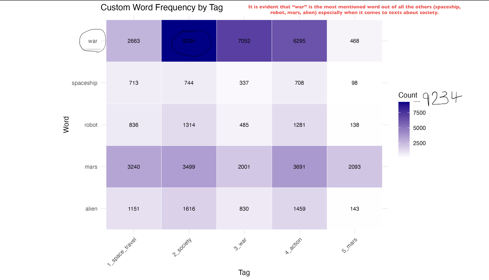
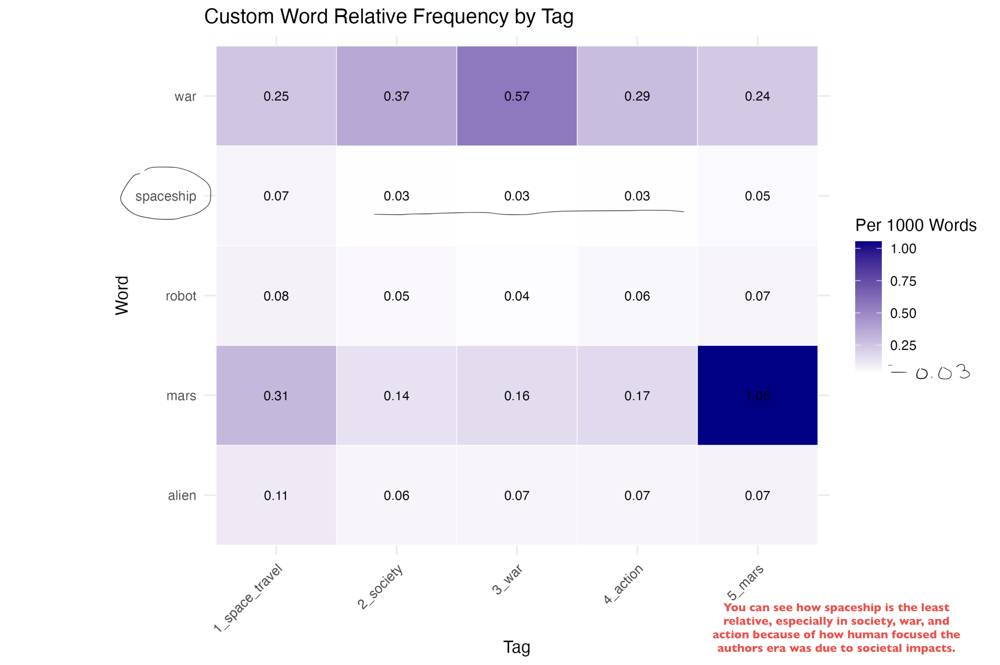
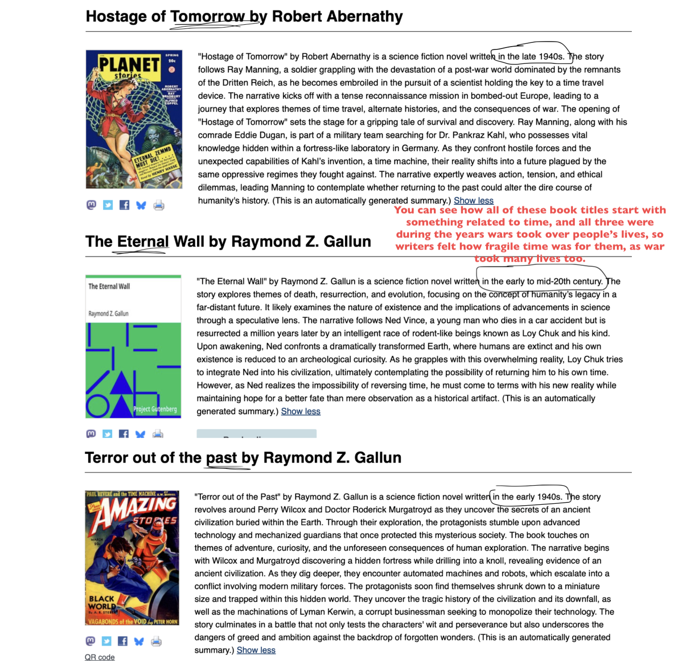
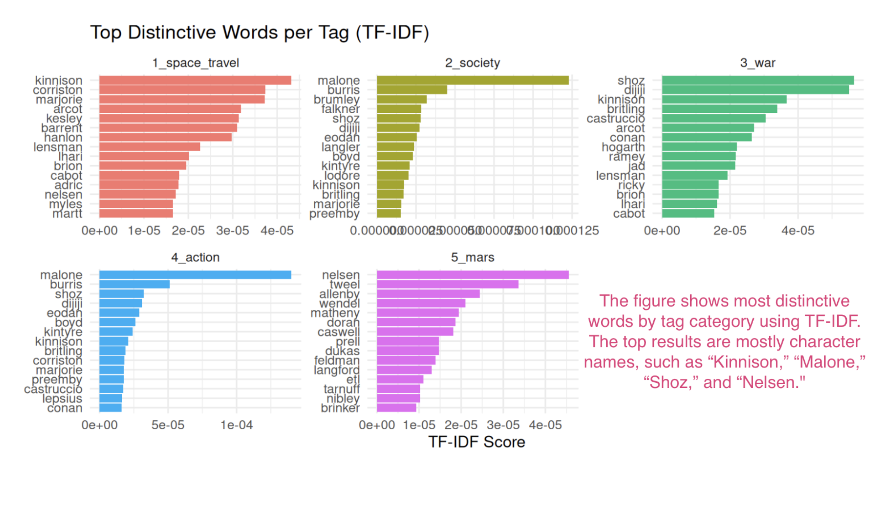

Reem Alzarooni, Sarah Farzaneh

Professor David Wrisley 

IM-UH 1511 Introduction to Digital Humanities

What is science fiction truly about? At first, we believed that science fiction was similar to fantasy novels, but by understanding it in depth, we now realize that it’s mainly only about space and technological advances, and how they influence human society. Our goal from this investigation is to determine whether science fiction focuses more on space exploration or on human society and conflict. Moreover, our hypothesis is that we assume that space and time will be brought up a lot; not only that, but we believe that time periods will significantly affect the commonalities in science fiction books.

Linear reading through 1,000 books, if possible, would be a tedious and laborious process. By using computational analysis, we were able to evaluate data much faster, without time pressure or mental strain. Reading that extreme number of texts would not have been feasible. Instead, by distant reading we were able to understand literature quantitatively. 

To begin with, we used the Word Frequency by Tag tool. We noticed that ‘war’ was the most common word out of everything, especially when it was about society. It was mentioned 9,234 times which was the only blue box compared to every other word, which indicates it being the only word found over 7,500 times. This highlights how a lot of science fiction books contain mentions of war, as hardships and battles build up on a story a lot, as well as make it more interesting. Also, another reason war is mentioned a lot is because of the era many of the science fiction books were written, as many were during the World Wars or the cold war which heavily impacted the thought process in writing these books. There were many system collapses, and power struggles between sovereigns during that era, which caused many wars to happen as economies fell, and rulers fought (caused fatal outbreaks). The authors also wrote while being influenced by the heavy technological advances of military machinery like: airplanes, chemical warfare, and the atomic bomb. We never expected that war would be brought up a plethora of times, as we initially thought space and time were going to be the most found words in every story.

Secondly, as we analyzed the patterns using the word relative frequency by tag tool, we realized that spaceship is the least relevant word in all the texts (space travel, society, war, action, mars). To add on, the color of its box was white for three texts which were: society, war, and action, demonstrating that it was 0.03 (lower than 0.25 of being relevant). The distinction matters here as one would expect texts that fall under the category of science fiction would always have spaceships being significant to the story, but it is evident now that this is not the case. The usual stereotype that follows sci-fi is that space travel will be very significant in all its stories, however society, political drama, and a wide mix of dystopian themes are more frequent. That is because writers of that era were far more interested in human life and how a society can survive during hard times, hence war being mentioned a lot due to it being a way people protect themselves when it comes to any enemy.

Moreover, we observed through the sci-fi metadata information to look at the statistics of the publication years, and the titles of the books which made us notice that that many of the titles from science fiction always had something to do with time, for example: “Terror Out of The Past”, “The Eternal Wall”, or “Hostage of Tomorrow" and so on. Even though there are other titles that do not have the mention of time in it, the commonality of time between these titles emphasizes the impact of time to human societies. One can never truly know what will happen next, or what the future will bring, which is exactly how science fiction notably displays the concept of time. This connects to how we thought ‘time’ will be touched on a lot when it comes to sci-fi. Additionally, the titles that mainly had mentions of time in them were more in the years 1941-1951, this is due to these being the years of the dropping of the Atomic Bomb, where it made many people feel that time was cut short from the amount of deaths there were. This made time feel fragile and something to obsess over for the authors of that age since it felt like time was literally ticking for them, and there were leaps in advancements of technology in that decade which made them feel how fast-moving society was advancing into the modern world.

Furthermore, we used the notebook’s feature of TF-IDF (Term Frequency-Inverse Document Frequency) to analyze the texts and figure which words appeared the most in one tag, but were rare in the other tags. Each category had a list of unique terms, mainly being names. Examples of this are “Kinnison” for space travel, “Malone” for society and action, “Shoz” for war, and “Nelsen” for Mars. We came to the conclusion that the most distinctive word in each group was a proper noun, indicating the character names in these books. Using TF-IDF is different from our previous approaches of analysis because it helped us identify specific terms for a particular group of texts, instead of just the most frequent across all texts. 

In relation to our previous findings, we decided to test out the word “Malone” using the KWIC (Keyword in Context) tool because it appeared in two categories (society and action) as the most distinctive word. We wanted to confirm if it was simply just a character’s name or if it had a specific connection to these categories. The results verified our initial assumption that Malone was a proper noun, specifically the last name of two characters. One of these characters being Johnny Malone from "Out of the Iron Womb!", whereas the other more frequently mentioned Malone was Kenneth J. Malone from "Braintwister". By figuring out the context surrounding this word, we were able to interpret Malone being a part of conversations or acting in different situations. This proved to us that a word can be distinctive in more than one category without necessarily representing a shared theme between them.

Throughout our research, we found that the notebook helped us identify patterns in many ways, showcasing different ways to display data: statistics, 1D & 2D heatmaps, word frequency, relative frequency, TF-IDF, and KWIC. These methods each aided us in understanding science fiction comprehensively. We were able to use corpus statistics to reveal the largest versus smallest texts; by using heatmaps, we could visualize the distribution of topics in each tag. Then, we employed the Word Frequency by Tag tool, which illustrated the recurrence of words in each tag. Also, we used the relative frequency tool, which measured word occurrences per 1.000 words, making comparisons fairer as it considered differing text lengths. From there, we could implement a more specific breakdown by adding date range restrictions to the texts. Next, we used TF-IDF that allowed us to find the most distinctive word in each tag group. Moreover, we combined filters based on year of publication, predicted gender, and stopwords to narrow down data. Finally, we used KWIC to examine specific words and their contextual words that surround them, which permitted us to understand how these words were used, instead of just how often.

Although the notebook tools offered us a multitude of methods to study the collection of texts, there were points of weaknesses. Most importantly, context was missing when using these approaches. For example, heatmaps showed the percentages of categories, but did not provide reasoning. Not only that, but when using TF-IDF, we realized that the most distinctive words didn’t necessarily reflect themes of the book; instead, results were character names, such as “Malone,” which we investigated further using KWIC. These limitations could be tied into Ted Underwood’s “The Risks of Distant Reading”, which discusses the risks of relying too much on computational analysis. As a result of distant reading, researchers may overlook the uniqueness of details and experiences fostered from close reading. Computational methods could also have underlying subjective human assumptions by the people who designed them, influencing the results researchers discover. Furthermore, using these tools requires intense training of technical skills and thoughtful interpretation, which is not a part of current university curriculums. Finally, discovering unexpected patterns can become distracting, causing a form of addiction as researchers become increasingly focused on producing more computational results rather than dissecting texts closely and finding hidden meanings. Our experience showed us that while computational tools are useful for identifying broad patterns, close reading is still crucial in understanding meaning and depth.

For first-time distant readers, working with 1,000 science fiction texts was empowering, despite its limitations. It allowed us to deconstruct a large collection of books and figure out major themes. However, it limited our ability to understand the hidden meanings and context that were in these stories. If we were to analyze more texts, we would use more filters and more generic wording to work out underlying patterns. Conversely, with a smaller range of texts, we would closely examine the data and attempt to grasp particular concepts. A subset that would be fascinating to work with is science fiction books published around 1939 - 1950s, mainly because we’re interested in the effects of war on human society and writing. Alternatively, if we had greater freedom and access to texts outside Project Gutenberg and the corpus, we would delve into more modern science fiction. Specifically, it would be Cyberpunk, a dystopian subgenre featuring marginalized groups defying a technology overtaken world and corporate dominance over society. We find it intriguing because of its relatability to our present world today.

In terms of our investigation’s transferability, the methods of distant reading can be applied in many other disciplines when doing research. For instance, we could use the word frequency tool on a large group of articles related to a topic such as  the preservation of endangered species. This method could help us identify recurring patterns and ideas that could help us understand the main concerns and strategies within this field. In the future, we could also extend these recently learnt skills into capstone projects about technology, helping us discover recurring subjects in technical discussions. 

Overall, this investigation changed how we understand science fiction and the ways it can be studied. Although we initially expected space exploration to dominate the genre, our findings highlighted the importance of human society in the collection we examined. Distant reading allowed us to explore a large number of texts efficiently, but still limited us in terms of reasoning and context. 

Contributions:--
Conceptualization: Reem Alzarooni and Sarah Farzaneh 

Methodology and formal analysis: Reem Alzarooni and Sarah Farzaneh

Writing- original draft: Sarah Farzaneh (exploratory analysis) and Reem Alzarooni (critical evaluation and conclusion)

Writing- review and editing: Reem Alzarooni and Sarah Farzaneh 

Visualization: Reem Alzarooni and Sarah Farzaneh 

AI Statement:
AI was used to help brainstorm ideas (polish them) as to improve the wording, and to clarify the language used. 

READY FOR GRADING

