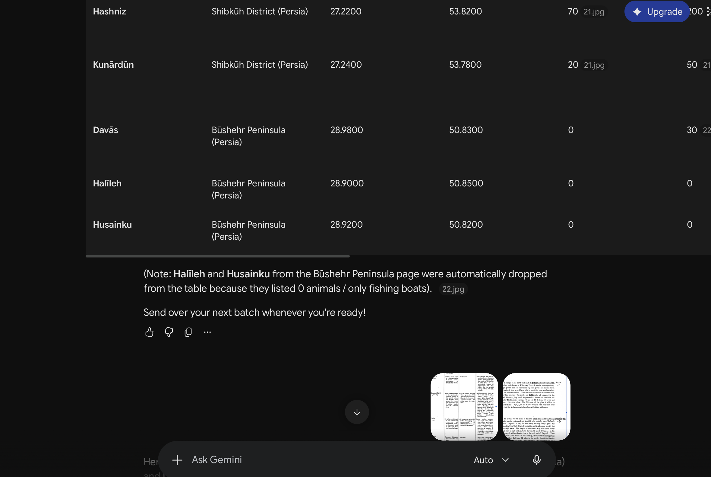

Reem Alzarooni, Sarah Farzaneh

Professor David Wrisley 

IM-UH 1511 Introduction to Digital Humanities

Exploring Animals from The Lormier’s Gazetteer Using Spatial Data 

The Lorimer’s Gazetteer (Vol.2) is a historical reference book written by J. G. Lorimer, a British official, in the early 1900s, demonstrated an inventory of resources, tribes, and geography. Also, the Lorimer’s Gazetteer provides a large variety of information based on the Gulf during a set period of time. From descriptions of regions, natural resources, population data, houses, and animals, we had a lot to choose from. However, we finally decided on exploring animals in the Gulf, specifically the Trucial States, which included the Emirates we know today, Bahrain, and Oman. These animals included but were not limited to camels, donkeys, cattle, horses, sheep, and goats.

Below is the map that shows the livestock, and amount of them in each place:

<iframe
  src="{{ '/assets/maps/Trucial States Animals.html' | relative_url }}"
  width="100%"
  height="650"
  style="border:0;"
  loading="lazy"
  title="Livestock map">
</iframe>

[Open the map in a new tab]({{ '/assets/maps/Trucial States Animals.html' | relative_url }}){:target="_blank"}

Additionally, the reason we picked the topic about animals, and the amount of livestock found in the Lorimer’s Gazetteer is because tracking livestock such as: camels, horses, sheep, goats, donkeys, cattle showcases the economic mobility, and survival with agriculture in specific locations. It also displays how the environment affected the animals found in places as it depends on what their habitat is. For example: there were more goats in the areas with warmer climates, like Ajman and Dubai, while in Fujairah, Masafi where there are a lot of mountains; more sheep were found. However, what we found surprising about all of this is how much the British focused on every small detail, from every single animal counted to its exact number everywhere. 

Our data was honestly pretty direct. Animal data was usually in a table of some sorts, providing a location, the type of animal, and the number of them (e.g. …. , 50 camels). However, some locations had sheep and goats counted together, while others had them separated, and we were not sure if these two animals amounted together or if they were just the same amount each. This resulted in us adding points with ‘sheep and goats’ when they were written together, and writing them as separate points if they were not written together. Moreover, sometimes the amount was very vague, it would say ‘a few camels’ but not specify them. This made us rarely add any animal that was under this category, as we were focusing on the amount of animals too for this assignment rather than just animals, so a specific amount mattered to us for the process, and we made sure it was put into the notes and stated as unclear, so that it would be known that there is no known amount for that animal.  

Further into the assignment, we created the prompt with the assistance of ChatGPT and Gemini, and Claude. Claude was used as we sent the prompt to it to see what it thinks of it, Gemini created a CSV file however when we wanted it to fix it as it displayed even the places that had 0 animals, it said that we ran out of free credits, so we switched to Claude to create a CSV file for Kepler. This is the main prompt we used: >>I want you to extract the words from here, and we are focusing on the amount of animals in all these pages, format it into a clean wide table that would be good for understanding, also we'll be uploading these into Kepler as a csv file, so keep that in mind when formatting. Use exact integers only in the animal columns. If Lorimer uses approximate wording (like 'about 50'), put the number in the column and record the exact wording in the notes section, and I want the latitude and longitude, make sure it's one row per location. If a location has absolutely zero animals, remove it.<< The last part stating that the places with zero animals should be removed was added after a lot of trial and error, as it simply did not make sense for the final version to contain any place with no animals. Kepler even displayed the location and mentioned a lot of ‘0 animals’ in the beginning, and this completely went away from the purpose of the assignment, therefore it was removed. 

[Download the dataset (CSV)]({{ '/assets/lorimer.csv' | relative_url }})

Moreover, what mainly helped us was “engineering” through experimental prompting. What facilitated our process was providing ChatGPT with the context of the assignment, requirements, and specific instructions. From that, we adjusted each new prompt based on issues we noticed from the previous one. For instance, Finally, the screen shots we collected were compiled in one Google Doc. From there, sending it to ChatGPT with our adjusted prompt became a simple step. The reason why we decided to put all the screen captures in one file is to ensure that the LLM does not hallucinate sources of unrelated information. 

Each two pictures were sent to the AI so that it would be easier for it to understand and analyze it, but with the recent technological advances, LLM’s are probably now able to analyze a high amount of data without it hallucinating or getting something wrong. It was the safer option to send images two by two though, so that it would be guaranteed that the AI will analyze it accurately.  

During the data extraction process, we faced issues of unstructured information scattered in tables. At first, we kept in mind the possibility of the AI extracting the wrong data or hallucinating information, so we would double check if the data in the spreadsheet was accurate and neat. Yet, we came to recognize a separate issue: in Lormier’s Gazetteer, animal species were sometimes grouped together, making AI confuse classifying sheep and cattle, combining them together. This relates to Karl W. Broman and Kara H. Woo’s claim in Data Organization in Spreadsheets. They state: “The cells in your spreadsheet should each contain one piece of data.” This idea stems from the importance of keeping data consistent and organized so that it can be easily processed and analyzed. In our case, the merging of differing animal species affected the count, therefore presenting an inaccurate map. Consequently, we realized the significance of an orderly data set because of the ways in which it affected our map execution in Kepler. 

While mapping our data, we noticed most animals recorded were on the upper side of the Trucial States, including Dubai and Fujaiarah. Most fascinating, though, was the large cluster of

If we were to do this again using many more pages, we believe the data would be harder to organize. With the amount of information, mistakes would appear more frequently. Additionally, it would take much more effort to prompt an LLM to extract that much data, if it is even possible. Nevertheless, if we successfully accomplish that first step, we suspect our map to have much more clusters

Exploring Lorimer’s Gazetteer was interesting because of its connection to the Gulf and the Trucial States. Beyond that, we believe investigating outside topics would be intriguing. Topics such as street cats worldwide, locations where films are made. On the other hand, a topic of interest would be mapping Reddit stories based on topic or comments. For example, we could extract data from the Am I The Asshole? (AITA) subreddit, and scan for comments suggesting the verdict of the OP: NTA, YTA, idk.. Similarly, we could gain access to Buzzfeed quizzes such as ‘What Character Am I?’ or ‘Am I a psychopath?’ Based on the location of the user when they completed the assessment, we could map characters or autism tests. 

Overall, we learned that a lot can come from mapping out animals in the Lorimier’s Gazetteer, as we found out how every single detail possible can pose great importance when it comes to the economy or the environment. Trade plays a role in making livestock extremely important for people, especially in the older generations, since animals were essential for farming, to signify social status, and the main food source for many. The reason why it indicates a high social status is due to the amount of animals, the more animals they had the more “perfect” their farm was.  

Contributions:--
Conceptualization: Reem Alzarooni and Sarah Farzaneh 

Methodology and formal analysis: Reem Alzarooni and Sarah Farzaneh

Writing- original draft: Sarah Farzaneh (exploratory analysis) and Reem Alzarooni (critical evaluation and conclusion)

Writing- review and editing: Reem Alzarooni and Sarah Farzaneh 

Visualization: Reem Alzarooni and Sarah Farzaneh 