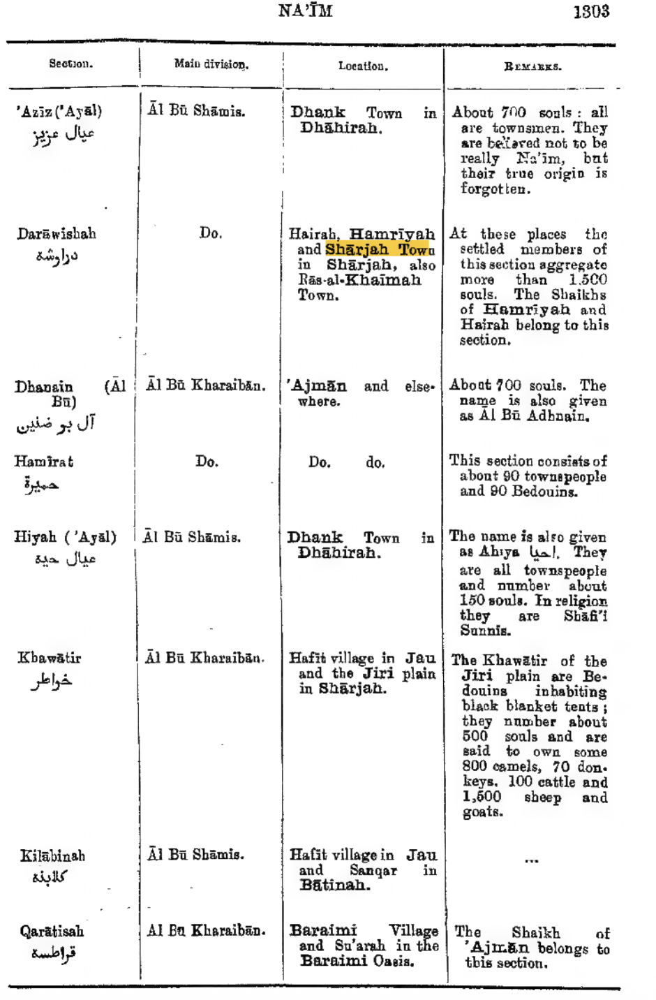

Reem Alzarooni, Sarah Farzaneh

Professor David Wrisley 

IM-UH 1511 Introduction to Digital Humanities

The Lorimer’s Gazetteer (Vol.2) is a historical reference book written by J. G. Lorimer, a British official, in the early 1900s, demonstrated an inventory of resources, tribes, and geography. Also, the Lorimer’s Gazetteer provides a large variety of information based on the Gulf during a set period of time. From descriptions of regions, natural resources, population data, houses, and animals, we had a lot to choose from. However, we finally decided on exploring animals in the Gulf, specifically the Trucial States, which included the Emirates we know today, Bahrain, and Oman. These animals included but were not limited to camels, donkeys, cattle, horses, sheep, and goats.

Below is the map that shows the livestock, and amount of them in each place:

<iframe
  src="{{ '/assets/maps/Trucial States Animals.html' | relative_url }}"
  width="100%"
  height="650"
  style="border:0;"
  loading="lazy"
  title="Livestock map">
</iframe>

[Open the map in a new tab]({{ '/assets/maps/Trucial States Animals.html' | relative_url }}){:target="_blank"}

Additionally, the reason we picked the topic about animals, and the amount of livestock found in the Lorimer’s Gazetteer is because tracking livestock such as: camels, horses, sheep, goats, donkeys, cattle showcases the economic mobility, and survival with agriculture in specific locations. It also displays how the environment affected the animals found in places as it depends on what their habitat is. For example: there were more goats in the areas with warmer climates, like Ajman and Dubai, while in Fujairah, Masafi where there are a lot of mountains; more sheep were found. However, what we found surprising about all of this is how much the British focused on every small detail, from every single animal counted to its exact number everywhere. 

Our data was honestly pretty direct. Animal data was usually in a table of some sorts, providing a location, the type of animal, and the number of them (e.g. …. , 50 camels). However, some locations had sheep and goats counted together, while others had them separated, and we were not sure if these two animals amounted together or if they were just the same amount each. This resulted in us adding points with ‘sheep and goats’ when they were written together, and writing them as separate points if they were not written together. Moreover, sometimes the amount was very vague, it would say ‘a few camels’ but not specify them. This made us rarely add any animal that was under this category, as we were focusing on the amount of animals too for this assignment rather than just animals, so a specific amount mattered to us for the process, and we made sure it was put into the notes and stated as unclear, so that it would be known that there is no known amount for that animal.  

Further into the assignment, we created the prompt with the assistance of ChatGPT and Gemini, and Claude. Claude was used as we sent the prompt to it to see what it thinks of it, Gemini created a CSV file however when we wanted it to fix it as it displayed even the places that had 0 animals, it said that we ran out of free credits, so we switched to Claude to create a CSV file for Kepler. This is the main prompt we used: “I want you to extract the words from here, and we are focusing on the amount of animals in all these pages, format it into a clean wide table that would be good for understanding, also we'll be uploading these into Kepler as a csv file, so keep that in mind when formatting. Use exact integers only in the animal columns. If Lorimer uses approximate wording (like 'about 50'), put the number in the column and record the exact wording in the notes section, and I want the latitude and longitude, make sure it's one row per location. If a location has absolutely zero animals, remove it.” The last part stating that the places with zero animals should be removed was added after a lot of trial and error, as it simply did not make sense for the final version to contain any place with no animals. Kepler even displayed the location and mentioned a lot of ‘0 animals’ in the beginning, and this completely went away from the purpose of the assignment, therefore it was removed. 

[Download the dataset (CSV)]({{ '/assets/lorimer.csv' | relative_url }})

Each two pictures were sent to the AI so that it would be easier for it to understand and analyze it, but with the recent technological advances, LLM’s are probably now able to analyze a high amount of data without it hallucinating or getting something wrong. It was the safer option to send images two by two though, so that it would be guaranteed that the AI will analyze it accurately.  
