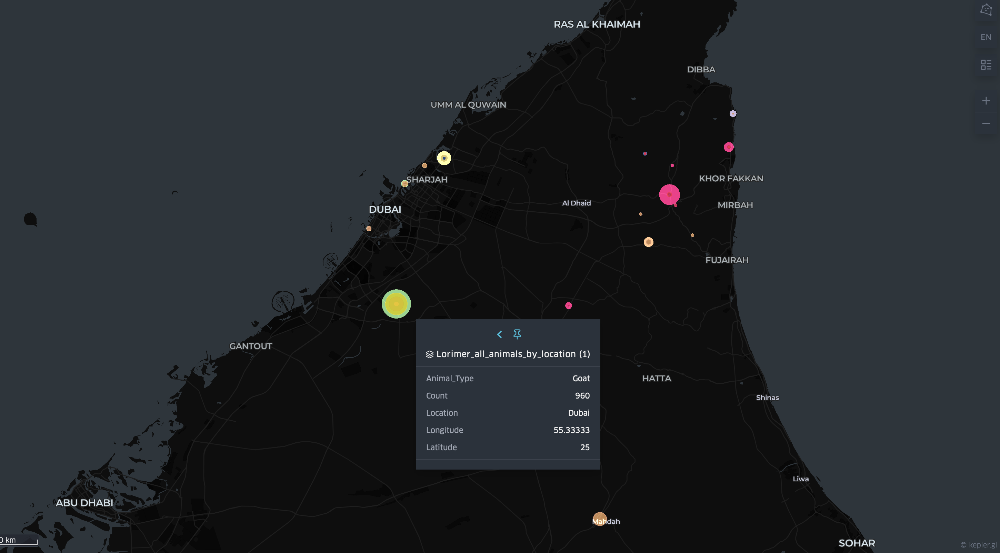

Reem Alzarooni, Sarah Farzaneh

Professor David Wrisley 

IM-UH 1511 Introduction to Digital Humanities

Exploring Animals from The Lormier’s Gazetteer Using Spatial Data 

The Lorimer’s Gazetteer (Vol.2) is a historical reference book written by J. G. Lorimer, a British official, in the early 1900s. It provides an inventory of resources, tribes, geography, and an overall large variety of information based on the Gulf during a set period of time. From descriptions of regions, natural resources, population data, houses, and animals; we had a lot to choose from. However, we finally decided on exploring animals in the Gulf, specifically the Trucial States, which included the Emirates we know today, Bahrain Island, and Trucial Oman. These animals included but were not limited to camels, donkeys, cattle, horses, sheep, and goats.

Below is the map that shows the livestock, and amount of animals in each place:

<iframe
  src="{{ '/assets/maps/kepler.gl.html' | relative_url }}"
  width="100%"
  height="650"
  style="border:0;"
  loading="lazy"
  title="Livestock map">
</iframe>

[Open the map in a new tab]({{ '/assets/maps/Trucial States Animals.html' | relative_url }}){:target="_blank"}

Additionally, the reason we picked the topic about animals, and the amount of livestock found in the Lorimer’s Gazetteer is because tracking livestock such as: camels, horses, sheep, goats, donkeys, cattle showcases the economic mobility, and survival with agriculture in specific locations. It also displays how the environment affected the animals found in places as it depends on what their habitat is. For example: there were more goats in the areas with warmer climates, like Ajman and Dubai, while in Fujairah, Masafi where there are a lot of mountains; more sheep were found. However, what we found surprising about all of this is how much the British focused on every small detail, from every single animal counted to its exact number everywhere. 

We chose to investigate the topic of animals because the amount of livestock found in the Lorimer’s Gazetteer such as camels, horses, sheep, goats, donkeys, and cattle could help elucidate the economic mobility and ways of survival in specific locations. It also displays how the environment affected the animals found in places as it depends on what their habitat is. For example: there were more goats in the areas with warmer climates, like Ajman and Dubai, while in Fujairah, Masafi where there are a lot of mountains; more sheep were found. Moreover, what we found surprising about all of this is how much the British focused on every small detail, from every single animal counted to its exact number in specific locations. This made us think about how colonial governments collected and organized this large set of information about populations and resources.

Our data was relatively pretty direct. Animal data was usually in a table of some sorts, containing a location, an animal species, and the quantity of it (e.g. 400 sheep or 50 camels). At first, we would search for each animal separately using keywords such as “camel”, “sheep”, “goat”. However, we soon realized a lot of the results referred to other regions such as the Persian Coast, Eastern Arabia, or Iraq, rather than the Trucial States. 

Instead of going through the tedious process of searching hundreds of pages at a time, we decided to use an existing data source containing the coordinates and locations mentioned in the Lormier’s Gazetteer. We filtered out the ‘region’ column to only include settlements associated with the Trucial States. Originally, we assumed we’d gather geographical information on the land that is now the modern UAE. Yet, we discovered a lot of those villages classified under ‘Trucial States’ also included modern Bahrain, Oman, and other areas. Accordingly, we decided to include those areas marked under ‘Trucial States’ so we can explore a wider area of the Gulf. 

Another unexpected element was terminology complications: some entries logged counts of sheep and goats together, while others had them separated. We were unsure if these two animals amounted together or if they were equally divided between two species. As a result, we created a separate "Sheep and Goats" category when they were recorded together, but still kept them as individual categories when they were listed separately. Moreover, sometimes the quantity of animals was very vague: it would say ‘a few camels’ but not specify them. This made us not add any animal that was under this category because we were focusing on the explicit amount of animals too for this assignment, rather than just animals. So, a specific number mattered to us for the process. Additionally, we made sure these estimated wording was added in our notes and stated as unclear, so that it would be clear that there is no known recorded number for that animal. 

Further into the assignment, we created the prompt with the assistance of ChatGPT and Gemini, and Claude. Claude was used as we sent the prompt to it to see what it thinks of it, Gemini created a CSV file however when we wanted it to fix it as it displayed even the places that had 0 animals, it said that we ran out of free credits, so we switched to Claude to create a CSV file for Kepler. This is the main prompt we used: >>I want you to extract the words from here, and we are focusing on the amount of animals in all these pages, format it into a clean wide table that would be good for understanding, also we'll be uploading these into Kepler as a csv file, so keep that in mind when formatting. Use exact integers only in the animal columns. If Lorimer uses approximate wording (like 'about 50'), put the number in the column and record the exact wording in the notes section, and I want the latitude and longitude, make sure it's one row per location. If a location has absolutely zero animals, remove it.<< The last part stating that the places with zero animals should be removed was added after a lot of trial and error, as it simply did not make sense for the final version to contain any place with no animals. Kepler even displayed the location and mentioned a lot of ‘0 animals’ in the beginning, and this completely went away from the purpose of the assignment, therefore it was removed. 

[Download the dataset (CSV)]({{ '/assets/lorimer.csv' | relative_url }})

Moreover, what mainly helped us was “engineering” through experimental prompting. What facilitated our process was providing ChatGPT with the context of the assignment, its requirements, and specific instructions. More importantly, we provided a CSV file consisting of the exact coordinates for locations mentioned in the Lormier’s Gazetteer. Then, the screenshots we collected were compiled in one Google Doc. The reason why we decided to put all the screen captures in one file is to ensure that the LLM does not hallucinate sources of unrelated information. From there, we adjusted each new prompt based on issues we noticed from the previous one. For example, when the AI included locations with zero animals or incorrectly grouped animal categories, we modified our instructions to address these problems. Finally, sending it to ChatGPT with our adjusted prompt became a simple step. 

During the data extraction process, we faced issues of unstructured information scattered in tables. At first, we kept in mind the possibility of the AI extracting the wrong data or hallucinating information, so we would double check if the data in the spreadsheet was accurate and neat. Yet, we came to recognize a separate issue: in Lormier’s Gazetteer, animal species were sometimes grouped together, making AI confuse classifying sheep and cattle, combining individual cases with the grouped ones. This relates to Karl W. Broman and Kara H. Woo’s claim in Data Organization in Spreadsheets. They state: “The cells in your spreadsheet should each contain one piece of data” (4). This idea stems from the importance of keeping data consistent and organized so that it can be easily processed and analyzed. In our case, the merging of differing animal species affected the count, therefore presenting an inaccurate map. Consequently, we realized the significance of an orderly data set because of the ways in which it affected our map execution in Kepler.  

Eventually, we were able to successfully map livestock distribution across different regions. Sheep and goats were particularly prominent in areas such as Badiyah and Wadi Ham, where several settlements recorded large combined populations of these animals. This may be connected to their ability to survive in relatively dry environments and their importance to pastoral livelihoods. In contrast, Dubai recorded a particularly high number of camels, with 1,650, reflecting their importance for transportation and trade in desert environments. Most fascinating, though, was the large cluster of donkeys in Bahrain. It displayed a different pattern, with donkeys appearing the most across its villages, suggesting their role in everyday transportation and local economic activities. Overall, the map illustrates how livestock populations were influenced by differences in geography, available resources and regional economic activities. 

If we were to do this again using many more pages, we believe the data would be harder to organize. With the amount of information, mistakes would appear more frequently. Additionally, it would take much more effort to prompt an LLM to extract that much data, if it is even possible. Nevertheless, if we successfully accomplish that first step, we suspect our map to have much more clusters. 

Exploring the Lorimer’s Gazetteer was interesting because of its connection to the Gulf and the Trucial States. Beyond that, we believe investigating outside topics would be intriguing. Possible ideas include mapping street cat feeding stations around the world or identifying locations where films were produced. On the other hand, something more niche would be mapping Reddit stories based on the comments’ overall consensus. For example, we could extract data from the Am I The Asshole? (AITA) subreddit and scan for comments suggesting the verdict of the original poster (OP): Not The Asshole (NTA), You’re The Asshole (YTA), or other responses. If the geographical information were available, we could compare these verdicts across different countries and investigate whether certain opinions or responses were more common in particular regions. Similarly, we could explore online personality quizzes, such as BuzzFeed’s “What Character Am I?” or the 16Personalities MBTI test. By mapping quiz results according to the countries where participants completed them, we could evaluate which fictional characters or personality types were most common in different countries and compare patterns across cultures.

Overall, we learned that a lot can come from mapping out animals in the Lorimier’s Gazetteer, as we found out how every single detail possible can pose great importance when it comes to the economy or the environment. Trade plays a role in making livestock extremely important for people, especially in the older generations, since animals were essential for farming, to signify social status, and the main food source for many. The reason why it indicates a high social status is due to the amount of animals, the more animals they had the more “perfect” their farm was.  

Contributions:--
Conceptualization: Reem Alzarooni and Sarah Farzaneh 

Methodology and formal analysis: Reem Alzarooni and Sarah Farzaneh

Writing- original draft: Sarah Farzaneh (exploratory analysis) and Reem Alzarooni (critical evaluation and conclusion)

Writing- review and editing: Reem Alzarooni and Sarah Farzaneh 

Visualization: Reem Alzarooni and Sarah Farzaneh 